# Protocol Boundary Network (PBN)

**A Security Layer for AI Agent Communication**  
By Tyler Walker

PBN is a proposed security layer for data-flow control across AI agent/tool boundaries. It focuses on the point where agents move data between tools, MCP servers, APIs, and downstream destinations.

## Watch the v4 demo

An agent reads a sample internal note and asks to copy it into two folders. It uses the same reference for both requests. The signed policy allows the note in the internal folder and refuses it in the public folder.

| Tool request | Observed result |
| --- | --- |
| Read `internal/review.txt` | The gateway returned a reference. The note text stayed out of the tool response. |
| Copy to `internal/copy.txt` | The gateway wrote the file. Its contents matched the original byte for byte. |
| Copy to `public/copy.txt` | The gateway refused the write. A check of the public folder confirmed that no file was created. |

The 16-second animation replays an offline run of the installed PBN 0.4.0 gateway on Linux. Build `4564168` passed all 331 local tests, including all 263 original tests and 68 added regression tests. The total includes 33 red-team cases run against an in-memory backend. [View the recorded results](demo/run.json)

## Whitepaper

The v3.3 technical draft is dated April 29, 2026.

- [PBN_Whitepaper.pdf](PBN_Whitepaper.pdf) - PDF version
- [PBN_Whitepaper.md](PBN_Whitepaper.md) - Markdown source
- [references.md](references.md) - supporting references

## Private Pilot

The implementation is private while it is being hardened for pilots. Private technical review and pilot access are available by request.

## Author

PBN was conceived by Tyler Walker.
